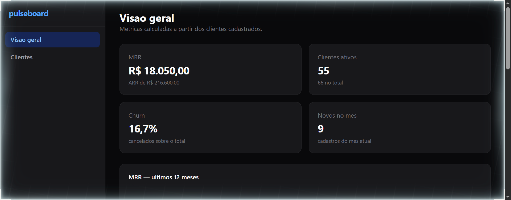
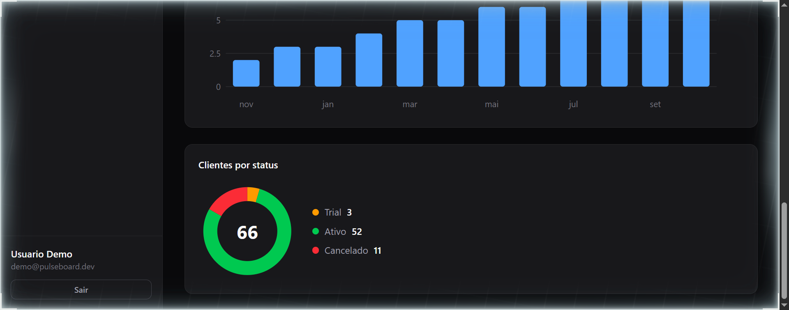
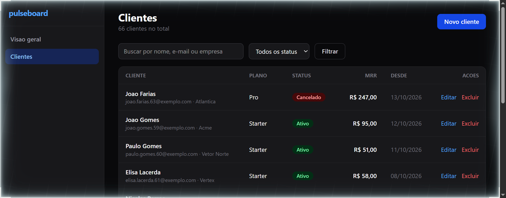
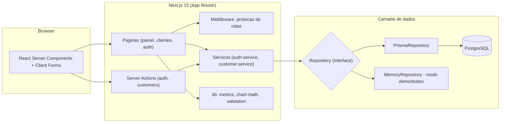

# pulseboard

[](https://github.com/Vitto-code/pulseboard/actions/workflows/ci.yml)


Dashboard SaaS fullstack que resolve um problema concreto de quem vende assinatura: responder rapido "quanto estou faturando por mes, quantos clientes ativos eu tenho e quantos cancelaram" sem abrir planilha. O pulseboard centraliza o cadastro de clientes e calcula MRR, ARR, churn e novos cadastros automaticamente, com graficos e historico de 12 meses.

## Demonstracao

O app tem autenticacao propria com sessao em banco, CRUD completo de clientes com busca e filtro por status, e uma visao geral com indicadores e graficos renderizados no servidor.

| Visao geral (KPIs) | Graficos (MRR, cadastros, status) | Clientes (CRUD + filtros) |
| --- | --- | --- |
|  |  |  |

Comportamento: ao entrar, o usuario ve MRR, clientes ativos, churn e novos do mes; abaixo, a evolucao de MRR dos ultimos 12 meses, os cadastros por mes e a distribuicao por status (trial, ativo, cancelado). Em "Clientes" e possivel buscar por nome, e-mail ou empresa, filtrar por status, criar, editar e excluir clientes — tudo com validacao no servidor e feedback de erro no formulario.

## Arquitetura



Detalhes em [docs/architecture.md](docs/architecture.md) e o raciocinio de cada escolha em [docs/decisions.md](docs/decisions.md).

## Decisoes tecnicas

- **Next.js 15 com App Router e Server Components**: as paginas do painel leem dados direto no servidor, sem camada de API REST nem estado de loading no cliente para leitura. Mutacoes usam Server Actions com revalidacao de cache. Trade-off: acopla front e back no mesmo deploy — aceitavel para um SaaS pequeno, e um monolito modular e mais facil de operar do que dois servicos.
- **PostgreSQL + Prisma**: banco relacional maduro com migracoes versionadas (`prisma/migrations`). Trade-off: exige Docker ou um Postgres local. Para contornar isso, toda a persistencia passa por uma interface `Repository` ([src/server/db/types.ts](src/server/db/types.ts)) com duas implementacoes: Prisma (producao) e memoria (`DB_DRIVER=memory`), usada nos testes e no modo demo.
- **Autenticacao propria (bcrypt + sessao em banco) em vez de Auth.js**: o objetivo era mostrar o fluxo completo — hash de senha, token de sessao, expiracao, cookie httpOnly, middleware de protecao — em vez de esconder tudo atras de uma biblioteca. Trade-off: nao tem OAuth nem reset de senha; em producao eu avaliaria Auth.js ou um provedor gerenciado.
- **Graficos SVG proprios, sem biblioteca de charts**: linha, barras e donut sao SVG renderizado no servidor a partir de funcoes puras em [src/lib/chart-math.ts](src/lib/chart-math.ts). Zero JavaScript de grafico no cliente e matematica 100% testavel. Trade-off: sem tooltips interativos — para um dashboard interno, o custo-beneficio compensa.
- **Vitest com injecao de dependencia**: servicos recebem o `Repository` por parametro, entao os testes rodam contra a implementacao em memoria, sem banco e sem mocks frageis. Cobertura de 94% com limiares de 70% travados no CI.

O que eu faria diferente com mais tempo: paginacao cursor-based na listagem (hoje o filtro roda em cima da lista carregada), troca de senha e recuperacao por e-mail, e multi-tenancy real (hoje todos os usuarios veem os mesmos clientes — deliberado para o demo).

## Como rodar

Pre-requisitos: Node.js 20+ e Docker (para o PostgreSQL). Alternativa sem Docker no final da secao.

```bash
git clone https://github.com/Vitto-code/pulseboard.git
cd pulseboard
npm install
cp .env.example .env

# sobe o PostgreSQL e aplica o schema
docker compose up -d db
npm run db:migrate

# popula com o usuario demo e 60+ clientes de exemplo
npm run db:seed

# inicia em http://localhost:3000
npm run dev
```

Login demo: `demo@pulseboard.dev` / `demo1234`.

**Sem Docker (modo demo em memoria):**

```bash
npm install
npm run dev:demo
```

O modo demo usa o `MemoryRepository` com os mesmos dados de exemplo; tudo funciona, mas os dados somem ao reiniciar. Com Make instalado, `make setup`, `make db`, `make migrate`, `make seed` e `make dev` cobrem o fluxo inteiro.

**Com PostgreSQL serverless (Neon) em vez de Docker:**

```bash
npm install
npx neon init -y          # vincula um projeto Neon (requer login)
npx neon deploy           # grava DATABASE_URL e DATABASE_URL_UNPOOLED em .env.local
npm run db:migrate
npm run db:seed
npm run dev
```

## Deploy (Netlify + Neon)

O app esta pronto para deploy continuo no Netlify com banco serverless no Neon:

1. Crie um projeto no [Neon](https://neon.com) (plano gratuito) e rode `npx neon init` + `npx neon deploy` na raiz — isso gera o `neon.ts` e o `.env.local`.
2. No Netlify: **Add new site → Import from GitHub → pulseboard**. O [netlify.toml](netlify.toml) instala o runtime oficial do Next.js e roda `prisma migrate deploy` a cada build.
3. Cadastre `DATABASE_URL` e `DATABASE_URL_UNPOOLED` (as strings do Neon) em **Site configuration → Environment variables**.
4. Popule os dados demo uma unica vez, do seu computador: `DATABASE_URL=<string do Neon> npm run db:seed`.
5. A partir dai, todo push na `main` dispara deploy com migracoes automaticas.

Nao use `DB_DRIVER=memory` em producao: em serverless a memoria e descartada entre requisicoes e a sessao de login nao sobrevive.

## Como testar

```bash
# testes unitarios (50 testes, sem banco)
npm test

# cobertura (limiares de 70% travados)
npm run test:coverage

# lint + checagem de tipos
npm run lint
```

Verificacao manual do fluxo de autenticacao:

```bash
# sem sessao, rota protegida redireciona para o login
curl -s -o /dev/null -w "%{http_code}\n" http://localhost:3000/clientes
# 307 (Location: /entrar?next=/clientes)

# pagina de login acessivel
curl -s -o /dev/null -w "%{http_code}\n" http://localhost:3000/entrar
# 200
```

No navegador: entre com o usuario demo, crie um cliente em "Novo cliente", edite o MRR e veja os indicadores da visao geral mudarem na hora. Teste tambem o caminho de erro: tente cadastrar um cliente com e-mail invalido ou MRR negativo — o formulario mostra a mensagem de validacao vinda do servidor.

## O que aprendi

1. **Server Actions com validacao compartilhada**: schemas zod em [src/lib/validation.ts](src/lib/validation.ts) validam o payload na action antes de tocar no servico, e o erro volta estruturado para o formulario — veja [src/app/actions/customers.ts](src/app/actions/customers.ts).
2. **O middleware do Next nao acessa o banco**: a protecao na borda so ve a presenca do cookie ([src/middleware.ts](src/middleware.ts)); a validacao real da sessao fica no layout protegido. Separar as constantes de auth em [src/server/auth/constants.ts](src/server/auth/constants.ts) foi necessario porque o middleware roda no runtime edge, sem `node:crypto`.
3. **Redirect loop de sessao expirada**: redirecionar o usuario logado para fora da pagina de login olhando so o cookie cria um loop quando a sessao morre no banco; a decisao precisa validar a sessao de verdade — corrigido nas paginas de auth.
4. **Metricas SaaS sao funcoes puras**: MRR, churn e series de 12 meses em [src/lib/metrics.ts](src/lib/metrics.ts) nao dependem de framework nem de banco, o que os torna triviais de testar — incluindo os casos de borda de fuso e virada de mes.
5. **Interface de repositorio como seguro contra indisponibilidade**: [src/server/db/types.ts](src/server/db/types.ts) permite trocar Prisma por memoria com uma variavel de ambiente, o que salvou a demonstracao e os testes num ambiente sem Docker.

## Estrutura

```
prisma/               schema, migracoes SQL e seed
src/
  app/
    (auth)/           login e cadastro (rotas publicas)
    (painel)/         visao geral e clientes (rotas protegidas)
    actions/          Server Actions de auth e clientes
  components/         formularios, tabela, badges e graficos SVG
  lib/                validacao (zod), metricas, matematica dos graficos, formatacao
  server/
    auth/             hash de senha, sessoes, servico de autenticacao
    customers/        regras de negocio de clientes
    db/               interface Repository + implementacoes Prisma e memoria
  middleware.ts       protecao de rotas na borda
tests/                50 testes unitarios com o repositorio em memoria
docs/                 arquitetura, decisoes e capturas de tela
```

## Licenca

MIT
