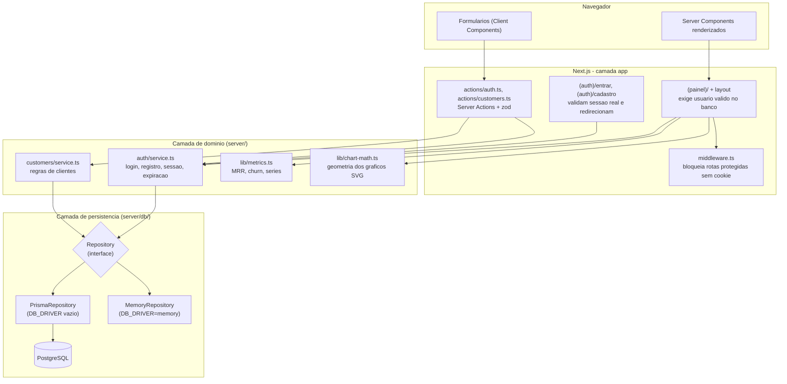
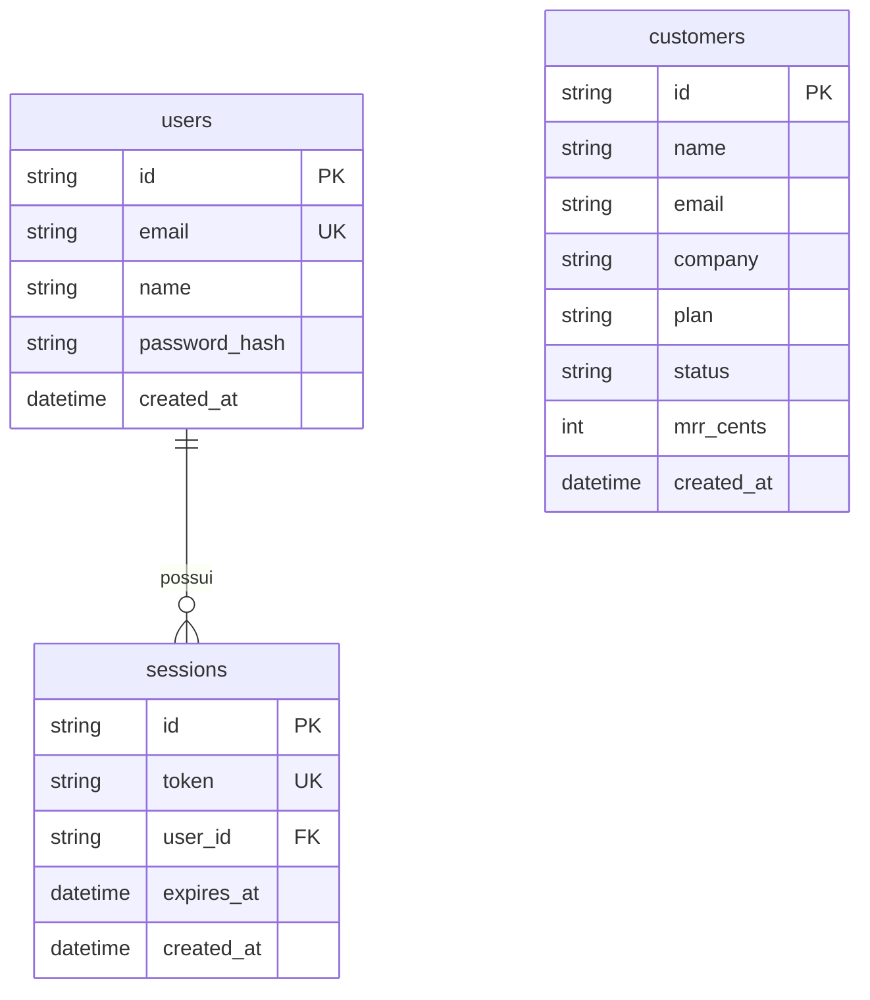

# Arquitetura do pulseboard

## Visao geral

Monolito modular em Next.js 15: interface, regras de negocio e persistencia no mesmo processo, com camadas bem separadas. Leituras acontecem em Server Components; escritas passam por Server Actions.



## Fluxo de autenticacao

```mermaid
sequenceDiagram
    participant B as Navegador
    participant M as Middleware
    participant A as Server Action
    participant S as auth/service
    participant R as Repository
    participant D as PostgreSQL

    B->>M: POST /entrar (form)
    M->>A: encaminha (rota publica)
    A->>A: valida payload com zod
    A->>S: loginUser(repo, email, senha)
    S->>R: findUserByEmail
    R->>D: SELECT user
    S->>S: bcrypt.compare
    S->>R: createSession(expira em 7 dias)
    R->>D: INSERT session
    A->>B: Set-Cookie httpOnly + redirect /
    B->>M: GET /clientes
    M->>M: cookie presente? senao redirect /entrar
    M->>B: segue para o layout protegido
    Note over B,D: o layout valida a sessao no banco;<br/>sessao invalida redireciona para /entrar
```

## Decisoes estruturais

- **Por que uma interface `Repository`?** Os servicos de dominio nao conhecem Prisma. Isso permite testes sem banco (`MemoryRepository`) e um modo demo completo sem Docker, trocado por uma unica variavel de ambiente (`DB_DRIVER`).
- **Por que metricas e graficos em `lib/`?** Sao funcoes puras sobre arrays e datas. Sem dependencia de React, Next ou banco, elas concentram a maior cobertura de testes do projeto.
- **Por que validacao em dois lugares?** O formulario valida no cliente para feedback rapido; a Server Action revalida com o mesmo schema zod, porque o cliente nunca e confiavel.
- **Onde mora o erro?** Erros de dominio usam classes tipadas em [../src/lib/errors.ts](../src/lib/errors.ts); as actions convertem para mensagens amigaveis e o servidor registra logs estruturados em JSON.

## Dados



O dinheiro e armazenado em centavos (`mrr_cents`, inteiro) para evitar erros de ponto flutuante; a formatacao em BRL acontece so na borda, em `lib/format.ts`.
